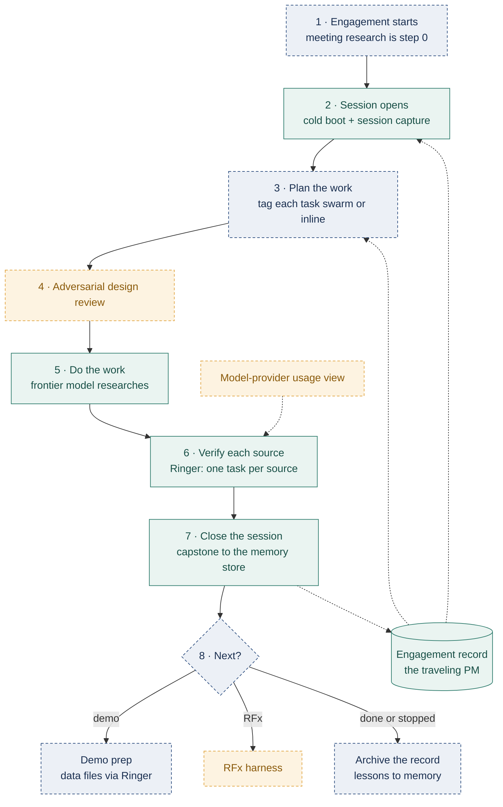

# AI Orchestration Layer

A phased orchestration stack: a frontier model plans and reviews, cheap verified workers execute, and every layer is built bottom-up on evidence from an eval log — Ringer dispatch first, LLM-judge verification second, workflow harnesses third, a Chief-of-Agents router last.

## Project Overview

This repo is the planning and build home for the next layer of a personal AI harness stack. The existing foundation (memory layer, skills, scheduled tasks) handles recurring individual jobs; this project adds the orchestration layer above it — dispatching batches of work to inexpensive parallel worker models, verifying every result, and accumulating the pass-rate history that eventually makes routing a query instead of a debate.

### Architecture flow

One engagement, followed from start to finish. The project manager (PM) is not a long-running chat. It is an **engagement record** that every fresh session reads at the start and writes back to at the end, in whichever repo the step belongs to. It lives at `~/Documents/Claude/Engagements/<prospect>/ENGAGEMENT.md` (started from a template), holds pointers to each repo's outputs rather than the outputs themselves, and stays out of git because it carries prospect material from step 0.



Teal = built and working. Navy dashed = decided, not built yet. Amber dashed = missing, or built and never run. Status as of 2026-10-25.

A task goes to a Ringer swarm only when it passes four tests: it is independent of other tasks, it has a check a script can run, a worker can do it from a written brief, and its data is allowed to leave the machine. The trigger is a step declared in the project's own `SKILL.md`, not a hook.

**Interactive version:** open [`docs/architecture-flow.html`](docs/architecture-flow.html) in a browser (it opens straight from disk). It steps through all eight steps in three views (before 2026-10-25, after, and the agreed target) and shows which pieces work at each step.

## Purpose

It exists because frontier-plan token caps are regularly hit on mechanical work, and because the four architecture patterns in circulation (batch dispatcher, harness, loop-of-loops, router) are usually conflated when they should be layered.

## Features

- **Phased build plan** (`BUILD-PLAN.md`): Ringer on code work → LLM-judge check pattern → presales harness → loops upgrade + router, with exit criteria and kill signals per phase.
- **Judge-check specification** (`SPEC-judge-check.md`): the interface for extending Ringer's exit-code verification contract to judgment work (documents, research, briefings) via rubric-scoring judge models — including mandatory shadow-mode calibration.
- **Escalation policy** (`ESCALATION-POLICY.md`): the decision-rights contract (Phase 2.6) — four lanes (auto-proceed+log / digest / block-and-ask / never-automate), post-graduation sampling plan, fault attribution, and the owner-interrupt metric. v1.1 hardened by a 3-model adversarial review swarm the day it was written.
- **Self-healing loop specification** (`SPEC-self-healing-loop.md`): the sentinel/repair pattern that lets scheduled jobs diagnose and fix their own transient failures unattended — two-error-class rule, immutable gates, append-only repair log, recurrence tripwire. Piloted live on a daily dashboard job 2026-07-15.
- **Ops Watcher + Mission Control** — built here as the Phase 4 attention layer (live 2026-07-27), **extracted 2026-07-28 to its own repo `Mission-Control-Dashboard`**. The escalation wiring stays: worker routines file Lane-2 findings into this repo's `runs/digest.jsonl` and the `evening-digest` task delivers them; Mission Control reads the queue cross-repo.
- **Scheduled-task backups** (`scheduled-tasks/`): scrubbed reference copies of the routines this repo's escalation policy governs: `skills-inventory-review`, `ops-watcher`, `evening-digest`, `action-item-triage`, `daily-ai-morning-briefing`, and `fleet-sentinel`. Every file in this folder is scrubbed to the convention below — absolute home paths to `~/`, owner name to "the owner", owner email to `<OWNER_EMAIL>`, launchd labels to `com.<OWNER>.` — so no copy here carries the account name. The largest of these, `skills-inventory-review` (titled **Monthly Maintenance Review** since 2026-10-10), runs four phases: (A) reads the Claude Code changelog and Anthropic release notes since the last run and maps each change to the instruction files it breaks, makes redundant, or could improve; (B) audits the local skill library for symlink breakage, duplicate/drifted `SKILL.md` copies, stale claude.ai uploads shadowing live skills, description-token bloat, harness-redundant instructions, and always-on CLAUDE.md overhead; (C) checks every owner repo — local clone or GitHub-only — against the repo standard; (D) when enabled, prepares fixes as unpushed commits on a `maint/<YYYY-MM>` branch in a separate worktree for the owner to review and push. It files Lane-2 findings to `runs/digest.jsonl` and a heartbeat to Mission Control, so its instructions belong beside the policy they implement. The committed copy is a backup for reading and diffing; the runtime master under `~/.claude/scheduled-tasks/` is what executes.
- **Sample manifest** (`samples/sample.swarm.json`): a reference Ringer manifest showing spec / check / expect_files / verified fields, including one judge-checked task.
- **Verification-first design**: exit code 0 or a calibrated judge verdict are the only accepted proofs; worker self-reports are never trusted.

## File Descriptions

| File | Role |
|---|---|
| `AGENTS.md` | Canonical guide for AI agents working in this repo — file map, data contract, invariants. |
| `README.md` | This human quickstart. |
| `project.toml` | This repo's project manifest — what a session here loads at start (memory scope, skills, review gates, done checks). |
| `llms.txt` | Machine-readable index. |
| `BUILD-PLAN.md` | Architecture, phased plan, decisions, risks, success metrics. |
| `docs/architecture-flow.html` | Interactive engagement-lifecycle stepper (before / after / target views). Self-contained; opens from disk. |
| `ESCALATION-POLICY.md` | Decision-rights contract: four lanes, sampling plan, fault attribution, interrupt metric (Phase 2.6). |
| `SPEC-judge-check.md` | Interface contract for the LLM-judge check pattern (Phase 2). |
| `SPEC-self-healing-loop.md` | Sentinel/repair pattern for scheduled jobs (Phase 4a pilot live; Phase 4b fleet sentinel + Slack command channel, approved 2026-08-31). Operator view: `Mission-Control-Dashboard/OPS-RUNBOOK.md`. |
| `SPEC-presales-harness.md` | Phase 3 harness design — stage map, adapters, tool policies, human gates, executed checks. |
| `SPEC-project-manifest.md` | `project.toml` contract — what engages when a session works on a project (built 2026-10-25). |
| `checks/judge.py` | LLM-judge runner (shadow scoring + owner-verdict logging). |
| `checks/verdict.sh` | One-line owner verdict: `checks/verdict.sh today pass`. |
| `checks/agreement.py` | Judge/owner agreement report — the ≥80% graduation instrument. |
| `checks/rubric-regression.sh` | Regression test proving a revised rubric line still fails a real violation. |
| `harness/run.py` | Phase 3 stage-3 driver (`prepare` / `merge` / `fault`). |
| `checks/rate_check.py` | Stage-3 rating check: verbatim citation resolution, six rules, per-req failure reasons. |
| `checks/matrix_check.py` | Integration gate over the merged matrix. |
| `checks/fault_report.py` | Fault-attribution report — the Phase 2.6 reader (class counts, routing signal, backlog). |
| `checks/manifest_check.py` | `project.toml` validator (SPEC-project-manifest §5.3); `checks/test_manifest_check.py` is its regression test, fixtures in `checks/fixtures/manifest/`. |
| `hooks/project-manifest-bootstrap.sh` | SessionStart hook that turns a project's `project.toml` into one short instruction block at session start (built and installed); test: `checks/test_manifest_bootstrap.py`. |
| `checks/review_gate.py` | Runs a project's declared `[review]` lenses as adversarial reviews (local subagents, or a Ringer swarm for public repos) and records the result; lens registry `checks/review_lenses.toml`; test: `checks/test_review_gate.py`. |
| `hooks/memory-first-gate.sh` | Tool-call hook that holds work in an owner-approved project until its memory scope is loaded, then has the session announce it (built, tested and installed); test: `checks/test_memory_gate.py`. |
| `skills/project-start/` | project-start skill and its manifest writer (`scripts/write_manifest.py`); test: `checks/test_project_start.py`. Built and installed. |
| `samples/sample.requirements.json` | Scrubbed stage-3 input adapter. |
| `rubrics/morning-briefing.md` | Briefing rubric (v2, 2026-07-31). Line IDs stable across versions. |
| `samples/sample.swarm.json` | Reference manifest (committed sample; real manifests are gitignored). |
| `scheduled-tasks/skills-inventory-review/SKILL.md` | Scrubbed backup of the Monthly Maintenance Review routine (release-note impact, skill audit, repo-standard sweep, prepared fixes). Reference copy — the runtime master lives under `~/.claude/scheduled-tasks/`. |
| `maintenance/repo_sweep.py` | Phase C: finds every owner repo (local clone, or a staging clone for GitHub-only repos) and runs `repo-check.py` on each; writes a JSON summary. |
| `maintenance/release_notes.py` | Phase A: Claude Code changelog entries since the last saved version, tagged by instruction surface and prioritized P1 (read) / P2 (scan) / drop. |
| `maintenance/prep_branch.sh` | Phase D: opens a fix branch in a separate git worktree so the clone in use is never touched. Never pushes. |
| `scheduled-tasks/ops-watcher/SKILL.md` | Scrubbed backup of the daily run-health sweep — the monitoring half of the escalation policy. Runtime master under `~/.claude/scheduled-tasks/`. |
| `scheduled-tasks/evening-digest/SKILL.md` | Scrubbed backup of the Lane-2 digest delivery routine — owns digest row status transitions. Runtime master under `~/.claude/scheduled-tasks/`. |
| `scheduled-tasks/action-item-triage/SKILL.md` | Scrubbed backup of the daily action-item triage the wiki dashboard depends on. Runtime master under `~/.claude/scheduled-tasks/`. |
| `scheduled-tasks/daily-ai-morning-briefing/SKILL.md` | Scrubbed backup of the morning briefing routine, judged by `checks/judge.py` against `rubrics/morning-briefing.md`. Runtime master under `~/.claude/scheduled-tasks/`. |
| `scheduled-tasks/fleet-sentinel/SKILL.md` | Scrubbed backup of the hourly fleet sentinel — the only component authorized to restart routines (Phase 4b: queue drain every hour, Class-1 sweep at 9AM/8PM, 2/day cap). Runtime master under `~/.claude/scheduled-tasks/`. |
| `CONTRIBUTING.md` | Commit format + README standards (canonical copy). |
| `CHANGELOG.md` | Dated log of notable changes. |
| `manifests/` | Real swarm manifests (gitignored — reference live work). |
| `runs/`, `*.jsonl` | Eval logs and run artifacts (gitignored). |
| `reports/` | Skills-review output (gitignored — carries local paths and personal identifiers). |

## How to Use

```bash
# Phase 1 prerequisite: Ringer itself (separate clone, not vendored here)
git clone https://github.com/NateBJones-Projects/ringer
cd ringer && ./ringer.py demo

# Then draft manifests in this repo's manifests/ dir, lint, and run:
./ringer.py lint ../AI-orchestration-layer/manifests/<name>.swarm.json
./ringer.py run  ../AI-orchestration-layer/manifests/<name>.swarm.json
```

Start with `BUILD-PLAN.md` for the current phase and its exit criteria. Manifest craft: every check must print WHY it fails (the failure output feeds the retry prompt).

**Mission Control dashboard:** now lives in the `Mission-Control-Dashboard` repo — open `~/Documents/Claude/Projects/Mission-Control-Dashboard/mission-control.html`.

### Update / refresh

Update `BUILD-PLAN.md` when a phase completes or a decision changes, add a dated `CHANGELOG.md` entry, and refresh this README on every `feat`/`fix`/`data` commit. Real manifests and eval logs stay out of git; commit a scrubbed sample instead when a new pattern is worth preserving. When a routine under `scheduled-tasks/` changes, edit the runtime master under `~/.claude/scheduled-tasks/` first — that is the copy that runs — then re-scrub it into this repo so the backup does not become a stale mirror. **The scrub convention applies to every committed file, not just `scheduled-tasks/`:** absolute home paths to `~/`, owner name to "the owner", owner email to `<OWNER_EMAIL>`, launchd label prefixes to `com.<OWNER>.` / `com.<OWNER-SHORT>.`. Before pushing, scan the tracked files for the owner's first and last name, the macOS account name, and any `/Users/<name>` path: `git ls-files -z | xargs -0 grep -nIE "$SCRUB_PATTERN"`, with `SCRUB_PATTERN` exported locally so the pattern itself is never committed. The review reports the task produces are gitignored and stay local.

## Data Sources

Architecture synthesized from: the Ringer guide (unlock-ai.natebjones.com/guides/ringer, verified 2026-07-10), Claire Vo's harness-anatomy build (How I AI), Nate B. Jones's loop-of-loops and 4-Patterns videos, and the steer-vs-dispatch Run Spec framework. Source syntheses live in the owner's knowledge base, not in this repo.

## Known Limitations

- The LLM-judge false-pass rate is unknown until shadow-mode calibration completes.
- **Shadow mode measures nothing without owner verdicts.** The first 12 shadow rows (2026-07-19..07-30) accumulated with zero owner verdicts — `--owner-verdict` existed but was never surfaced where the owner reads the artifact, so the agreement rate stayed unmeasurable rather than merely unmet.
- Rubric revisions can over-correct: removing a false positive can leave a line that no longer fails anything.
- Worker CLIs must be kept current: an out-of-date Codex CLI (0.139.0) was rejected wholesale by its own default model (`gpt-5.6-sol` requires a newer CLI) — every demo task failed until the CLI self-updated to 0.144.4.
- Ringer worktree footgun: passing tasks get their worktrees deleted.
- A Cowork sandbox cannot run git on mounted folders.
- **Release notes are matched by keyword.** `release_notes.py` tags changelog lines by keyword and prioritizes by first word; a relevant change worded unusually can land in `drop`. Anthropic's app/API release-notes pages are fetched by the routine itself, not by the script.
- **A routine that heartbeats only sometimes defeats `watch.py`'s `stalled` verdict.** The verdict is guarded on heartbeat history, so a routine that never reports cannot false-alarm, but one that reports at the model's discretion reads as "parked on an approval prompt" on every day it skips the footer. `ops-watcher` was that routine until 2026-09-08 (fleet-sentinel paged the owner on 9/3 and 9/7 for a 9/7 run that had completed).

## Workarounds

- **Judge false-pass rate:** the judge gates nothing until judge/owner agreement is ≥80%. Externally facing deliverables keep a permanent human gate regardless.
- **Missing owner verdicts:** fixed 2026-07-31 (`checks/verdict.sh` + a mandatory prompt line in the briefing pipeline); `python3 checks/agreement.py` reports the rate, the disagreements, and the unpaired backlog.
- **Rubric over-correction:** `checks/rubric-regression.sh` injects a known violation and asserts the line still fires.
- **Stale worker CLIs:** keep the worker CLI current before a run; the failure above cleared once the CLI updated to 0.144.4.
- **Ringer worktree deletion:** checks must copy deliverables out before exiting 0.
- **No git in a Cowork sandbox:** commits and pushes are run by the owner in Terminal.
- **Keyword-matched release notes:** every entry, including dropped ones, stays in the run's `release-notes.json`, so a missed change can be found by searching that file.
- **Intermittent heartbeats:** `ops-watcher`'s SKILL.md now carries an unconditional step-8 footer. Any new routine must get its footer in the spec, never left to habit.

## Build Notes

Phase 1 plumbing is live as of 2026-07-15: Ringer demo verified, and two worker lanes proven end to end — Codex CLI (plan-billed) and OpenCode + OpenRouter (`z-ai/glm-5.2`, ≈$0.01 per verified task; key held in OpenCode's auth store, never in this repo). As of 2026-07-22 the first runtime code lives here: `checks/judge.py` (the SPEC-judge-check LLM-judge, live in shadow mode against the morning briefing) and `rubrics/morning-briefing.md` (rubric **v4** as of 2026-09-25: v2's lines revised from 12 shadow rows on 2026-07-31; v3 adds `hard_fail: R4`, so an invented date, placeholder or missing source fails the edition outright regardless of score; v4 adds `mechanical: R10=weekday-date`, so the weekday/date check is computed in code rather than judged by the model); shadow verdicts accumulate in the gitignored `runs/judge-shadow.jsonl`, and owner verdicts land beside them via `checks/verdict.sh`. Phase 1 adopts Ringer as-is (single-file Python orchestrator, Python 3.11+) rather than building a dispatcher; Phase 2 adds the only novel component (judge checks) as plain shell/Python scripts conforming to `SPEC-judge-check.md`; Phase 3 builds one harness on the Claude Agent SDK. The router is deliberately last: routing decisions come from accumulated per-model, per-task-type pass rates, not intuition.

---
*Last updated: 2026-10-25*
